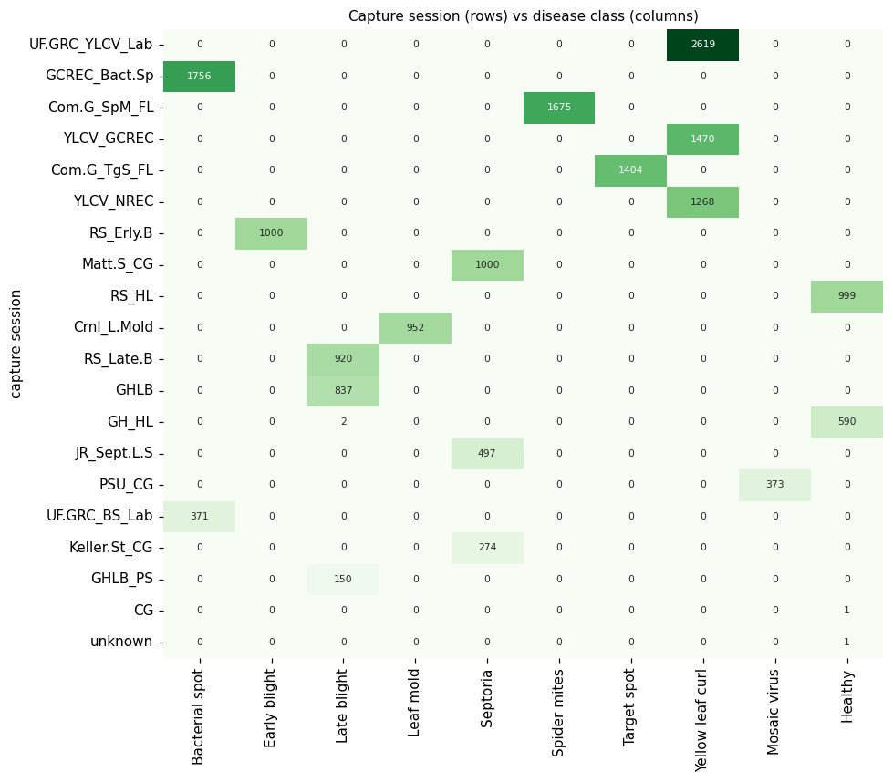
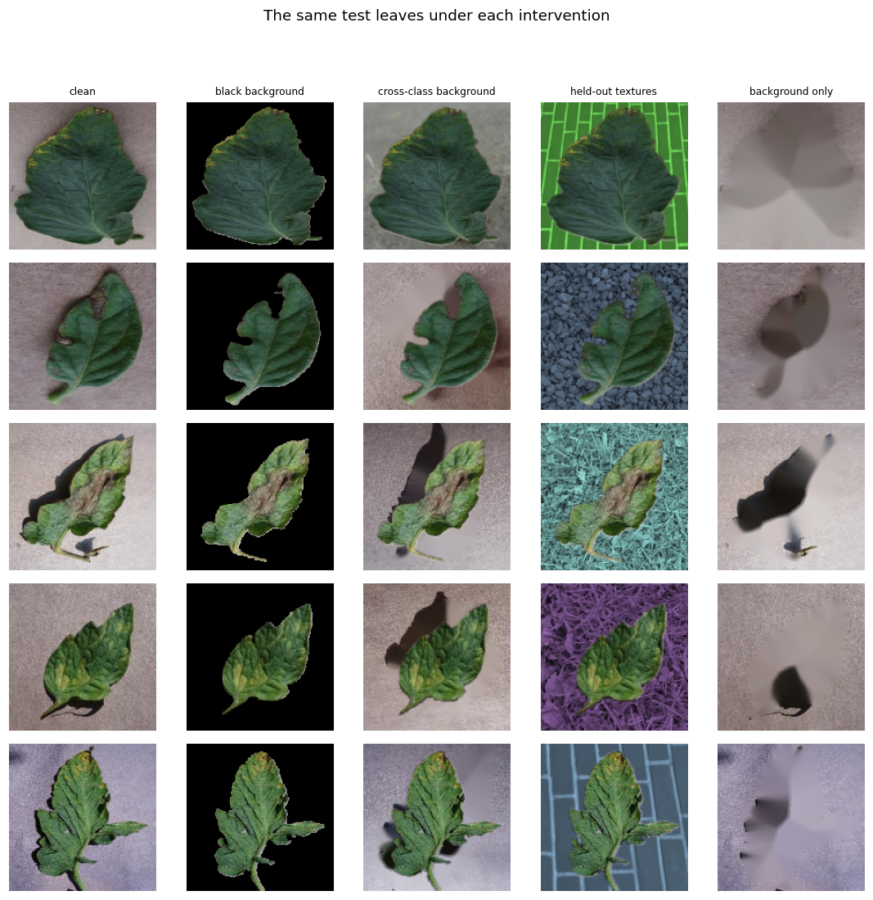
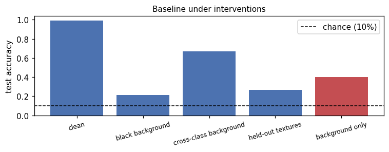
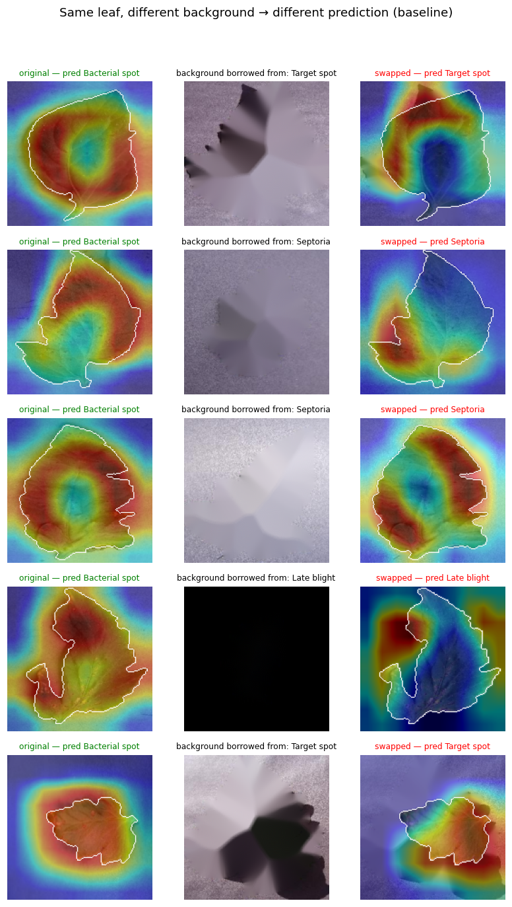
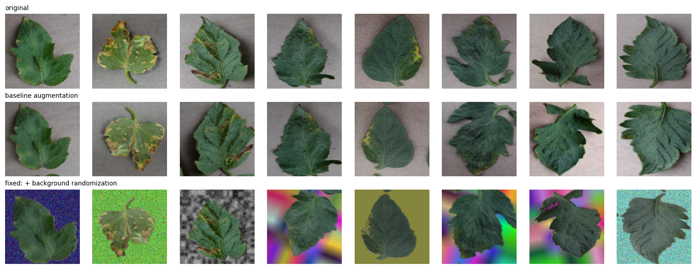
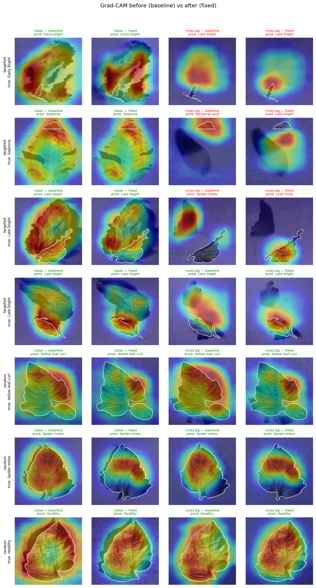
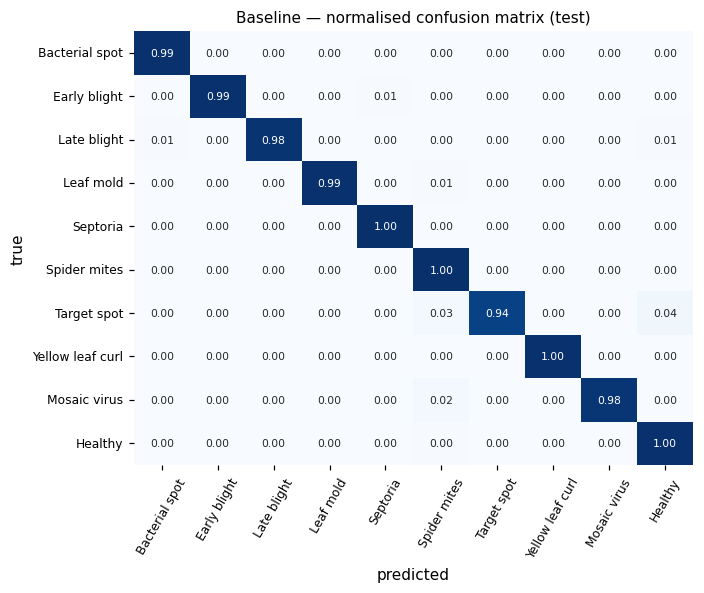
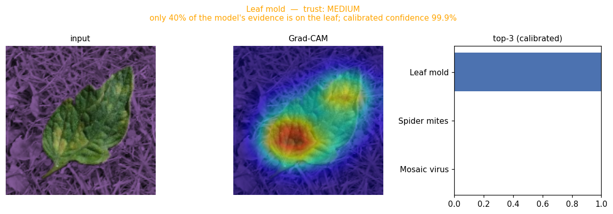
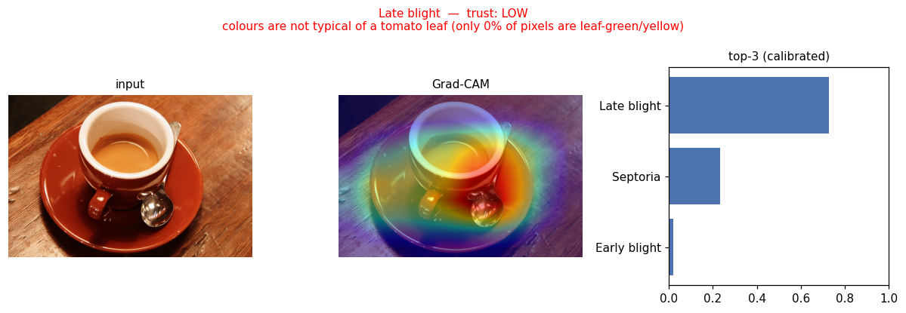

# Trustworthy Tomato Leaf Disease Detection with Grad-CAM

**Diagnose → Fix → Measure:** a CNN that scores 99% on PlantVillage tomato leaves turns out to be reading the photo *background*. This project uses Grad-CAM and controlled image edits to prove it, removes the shortcut with mask-guided background randomization, measures the result honestly, and ships an inference tool that returns a **prediction, a Grad-CAM heatmap and a trust level**.

[](https://colab.research.google.com/github/natanamanuelmamo/GradCAM_CNN/blob/main/Natan_Amanuel.ipynb)


> Built for the iCog Labs CNN & Grad-CAM training assignment, *"Build a Trustworthy Plant Disease Detection System"*. Everything is in one fully-executed notebook: [`Natan_Amanuel.ipynb`](Natan_Amanuel.ipynb).

---

## Contents

- [Results at a glance](#results-at-a-glance)
- [The story](#the-story)
- [Method](#method)
- [Results](#results)
- [The inference tool](#the-inference-tool)
- [How to run](#how-to-run)
- [Repository structure](#repository-structure)
- [Notebook guide](#notebook-guide)
- [Limitations](#limitations)
- [Next steps](#next-steps)
- [References](#references)

---

## Results at a glance

Test-set accuracy, mean ± standard deviation over two training seeds. The tests marked *held-out* use backgrounds that the fixed model never saw during training.

| Test condition | Baseline CNN | Fixed CNN | Change |
|---|---|---|---|
| Clean test images | 99.0% ± 0.1 | 96.9% ± 1.0 | −2.1 |
| Leaf on another class's background *(held-out)* | 66.5% ± 0.8 | **94.5% ± 1.0** | **+27.9** |
| Leaf on real texture photos *(held-out)* | 26.8% ± 0.0 | **72.0% ± 0.6** | **+45.2** |
| Leaf on black background | 19.1% ± 2.7 | **90.9% ± 2.5** | **+71.8** |
| Leaf removed, background only *(lower is better; chance = 10%)* | 42.2% ± 3.1 | **11.4% ± 0.6** | −30.9 |
| Prediction switches to the background's class *(lower is better)* | 11.7% ± 0.1 | **0.9% ± 0.2** | −10.8 |
| Grad-CAM peak lies on the leaf | 87.4% ± 0.7 | **96.8% ± 0.4** | +9.4 |

**In one sentence:** the baseline's 99% partly came from recognising *where* a photo was taken; after the fix, the model ignores the background (it is at chance when the leaf is removed) and holds up on backgrounds it never trained on, at a measured cost of 2.1 points on the original lab images.

---

## The story

### 1. A result that looks great

A small CNN trained from scratch on 18,159 PlantVillage tomato images reaches **99.0% test accuracy** and **98.9% macro-F1**.

### 2. A reason to doubt it

PlantVillage file names encode the **capture session** (site, day, setup). Cross-tabulating sessions against classes shows that **all 20 sessions contain exactly one disease**. Anything that identifies the session, such as the table surface, lighting or shadows, therefore identifies the label.



### 3. Investigating with Grad-CAM

Grad-CAM (implemented from scratch and verified with a model-randomisation sanity check) shows the baseline putting **34% of its evidence on the background**, with the heatmap peak off the leaf on **12%** of test images. That is a hint, not proof: a heatmap shows *where* a model looks, not whether that region *changes the answer*.

### 4. Proving it with interventions

To establish cause, the test images are edited so that only the background changes:



| Condition | Baseline accuracy |
|---|---|
| Clean | 99.0% |
| Leaf removed (background only) | **40.0%** (chance is 10%) |
| Leaf on another class's background | **67.1%** |
| Leaf on held-out textures | 26.8% |
| Leaf on black background | 21.0% |



Of the 830 test images that became wrong after a background swap, **299 (36%) switched to exactly the class the background came from**. Same leaf, different background, different answer:



A Random Forest trained on **background colours only** reaches **86.9%**, confirming the shortcut lives in the data itself.

> **Failure pattern — background shortcut.** The baseline uses the photo's background, which identifies the capture session and therefore the class, as evidence for the disease.

### 5. A fix that targets the cause

The cause is a spurious correlation in the training data, so the fix removes it at the source: during training, with probability 0.8, each leaf is cut out with its mask and pasted onto a **random synthetic background**. The background then carries no information about the label, so the model has no reason to use it.



Everything else (architecture, data split, hyper-parameters, epochs, seeds, other augmentation) is identical, making the before/after a **controlled experiment**.

### 6. Measuring honestly

The fixed model is evaluated on backgrounds it **never** trained on (real backgrounds from other classes and real texture photos), so the test checks that it learned to ignore backgrounds in general rather than memorising the training trick. The results are in [the table above](#results-at-a-glance), and the cost on clean images is reported, not hidden.



---

## Method

### Data

- **Dataset:** the 10 tomato classes of [PlantVillage](https://github.com/spMohanty/PlantVillage-Dataset): 18,159 images, each with a **segmented twin** (background removed) from which an exact leaf mask is derived.
- **Download:** a partial, sparse `git clone` fetches only the tomato `color` and `segmented` folders. No account or API key is needed.
- **Leakage-free split:** 291 leaves were photographed more than once (`Leaf 154`, `Leaf 154.1`, …). The data is split **by physical leaf** with `StratifiedGroupKFold` into about 70 / 15 / 15 (12,974 / 2,598 / 2,587 images). No leaf appears in both train and test.
- **Resolution:** images are resized from 256 to 160 px and cached in RAM, with augmentation done on the GPU.

### Model: `TomatoCNN` (trained from scratch)

```
input 3×160×160 → normalise
block 1  [Conv3×3 → BN → ReLU] ×2,  32 ch → MaxPool → 80×80
block 2  [Conv3×3 → BN → ReLU] ×2,  64 ch → MaxPool → 40×40
block 3  [Conv3×3 → BN → ReLU] ×2, 128 ch → MaxPool → 20×20
block 4  [Conv3×3 → BN → ReLU] ×2, 256 ch → MaxPool → 10×10
block 5  [Conv3×3 → BN → ReLU] ×2, 256 ch (no pool)   10×10  ← Grad-CAM layer
global average pooling → dropout 0.3 → linear → 10 logits
≈ 2.36 M parameters
```

The last block keeps a 10×10 map (instead of 5×5) so that Grad-CAM heatmaps are fine enough to separate leaf from background.

### Training

| Setting | Value | Reason |
|---|---|---|
| Optimiser | AdamW, weight decay 5e-4 | Robust default for training from scratch |
| Learning rate | One-cycle, max 2e-3 | Warm-up then smooth annealing |
| Epochs / batch | 25 / 64 | |
| Loss | Cross-entropy, label smoothing 0.05 | Discourages over-confidence |
| Augmentation | Flips, ±25° rotation, ±12% scale, ±8% shift, ±20% brightness/contrast/saturation | **No hue shift:** colour is a disease symptom |
| Model selection | Early stopping on validation **macro-F1** | Classes are imbalanced about 14:1 |
| Precision | Mixed (AMP) on GPU | About 2× faster |
| Seeds | 0 and 1 | Separates real effects from run-to-run noise |

### Grad-CAM

For the class logit $y^c$ and the last conv block's feature maps $A^k$:

$$\alpha_k^c = \frac{1}{Z}\sum_{i,j}\frac{\partial y^c}{\partial A^k_{ij}}, \qquad L^c_{\text{Grad-CAM}} = \mathrm{ReLU}\Big(\sum_k \alpha_k^c A^k\Big)$$

- Implemented from scratch with forward and tensor hooks, **batched**, so heatmaps are computed for the whole test set and **measured**, not just viewed.
- **Sanity check** (Adebayo et al., 2018): heatmaps from a randomly re-initialised model are unrelated to the trained model's (Spearman ρ = 0.09), and maps for the top-1 and 2nd class differ (ρ = −0.01).
- **Quantified** with the leaf masks: energy share in the leaf interior, leaf boundary and background; attention lift (energy share ÷ area share); and the pointing game (is the peak on the leaf?).

### Statistical testing

**McNemar's test** compares the two models on the same images:

| Condition | Only baseline right | Only fixed right | p-value |
|---|---|---|---|
| Clean | 84 | 13 | 7 × 10⁻¹⁴ |
| Another class's background | 39 | 728 | < 10⁻¹⁰⁰ |
| Held-out textures | 136 | 1,294 | < 10⁻¹⁰⁰ |

---

## Results

### Baseline (per class, seed 0)



The weakest classes are Target spot (F1 0.964), Healthy (0.977) and Spider mites (0.982). The most frequent mistake is **Target spot → Healthy** (8 images).

### What the fix achieved

- **The shortcut is gone:** with the leaf removed, accuracy drops to chance (11.4%), and the model almost never follows a foreign background (0.9%).
- **It generalises to unseen backgrounds:** +27.9 points on real backgrounds from other classes, +45.2 on real texture photos, +71.8 on black backgrounds.
- **Attention moved to the leaf:** Grad-CAM energy on the leaf rose from 54% to 65%, and the peak is on the leaf for 97% of images.

### What it cost

Clean accuracy fell from **99.0% to 96.9%**, and McNemar's test says this is a real difference. Early blight and Target spot lost the most (F1 about 0.90 each). Two reasons:

1. The clean test set contains the same shortcut as the training set, so part of the baseline's 99% was earned from the background.
2. The fixed model faces a harder task and was still improving when training stopped at epoch 25, so it is probably under-trained.

The fix is also incomplete: 72% on realistic textures is far better than 27%, but well below clean accuracy.

---

## The inference tool

```python
p = predict("path/to/leaf.jpg")   # also accepts a PIL image or a NumPy array, any size or colour mode
p.label        # e.g. "Late blight"
p.confidence   # calibrated probability of the top class
p.top3         # [(class, probability), ...]
p.heatmap      # Grad-CAM map at the original image resolution
p.overlay      # heatmap drawn on the image
p.trust        # "HIGH" | "MEDIUM" | "LOW"
p.reasons      # plain-language reasons for the trust level
p.show()       # draws input, heatmap and top-3
```

The trust level combines three independent signals:

1. **Calibrated confidence** (temperature scaling, T = 0.69, fitted on validation data).
2. **Explanation check:** the share of Grad-CAM evidence on the leaf. The leaf is estimated with a colour segmenter, since new photos have no ground-truth mask. This turns the diagnosed failure into a runtime check.
3. **Input check:** is there a leaf at all (leaf area, leaf-coloured pixels)?

| Level | Rule |
|---|---|
| LOW | Input check fails, or confidence below the MEDIUM cut-off |
| HIGH | Confidence ≥ HIGH cut-off **and** ≥ 50% of the evidence on the leaf |
| MEDIUM | Everything else |

Cut-offs are chosen on validation data for target accuracies (99% for HIGH, 90% for MEDIUM) and then checked on the test set:

| Trust level | Clean: share / accuracy | Another class's background | Held-out textures |
|---|---|---|---|
| HIGH | 80.3% / **98.9%** | 77.5% / 98.6% | 39.9% / 88.0% |
| MEDIUM | 18.5% / 84.5% | 20.4% / 76.5% | 54.8% / 60.8% |
| LOW | 1.2% / 93.8% | 2.0% / 83.0% | 5.3% / 60.6% |

**HIGH is reliable** on familiar conditions, and the tool becomes more cautious on unfamiliar ones (only 40% HIGH on textures). Two examples where confidence alone would mislead:

| Leaf on an unseen texture: 99.9% confident, but only 40% of the evidence is on the leaf → **MEDIUM** | Not a leaf at all: 73% confident → **LOW** |
|---|---|
|  |  |

**Known weaknesses, reported openly:**

- **MEDIUM is too permissive.** Its cut-off came out at 0.20 because validation accuracy already exceeded the 90% target, so almost nothing is rated LOW for low confidence. On clean images MEDIUM (84.5%) is even less accurate than LOW (93.8%).
- **Temperature scaling did not transfer.** On the mixed test set, calibration error rose from 0.015 to 0.052, because T was fitted on easier images than the test mix.

The trained model, temperature and thresholds are saved together to `artifacts/final_model.pt`.

---

## How to run

### Option A: Google Colab (recommended)

1. Click the **Open in Colab** badge at the top.
2. Choose **Runtime → Change runtime type → T4 GPU**.
3. Choose **Runtime → Run all**.

The full run takes about **50–60 minutes** (four models of about 10 minutes each, plus evaluation) and peaks at about **7.5 GB of RAM**, within the free tier. The first cell should print `device: cuda (Tesla T4)`.

Optional switches in section 7:

```python
UPLOAD, LAUNCH_GRADIO = False, False   # set UPLOAD=True to classify your own photo,
                                       # LAUNCH_GRADIO=True for a small web demo
```

### Option B: locally

Requires Python 3.10+, `git` on your PATH, and ideally an NVIDIA GPU (CPU works but training takes hours).

```bash
git clone https://github.com/natanamanuelmamo/GradCAM_CNN.git
```

```bash
cd GradCAM_CNN
```

```bash
python -m venv .venv
```

Activate the environment (`source .venv/bin/activate` on Linux/macOS, `.venv\Scripts\activate` on Windows), then:

```bash
pip install -r requirements.txt
```

```bash
jupyter notebook Natan_Amanuel.ipynb
```

The notebook downloads the dataset into `./data` (about 400 MB of images plus a 1.9 GB cache) and writes models and results to `./artifacts`. Both are git-ignored.

> **Windows note:** some PlantVillage file names are long and can exceed Windows' 260-character path limit. If images fail to load, point the data folder at a short path before starting Jupyter, e.g. `set DATA_ROOT=C:\pv` (cmd) or `$env:DATA_ROOT="C:\pv"` (PowerShell).

### Quick code check

Setting the environment variable `SMOKE_TEST=1` runs the whole notebook on 24 images per class for 1 epoch, which is useful for checking that everything executes (a few minutes on CPU). The numbers from such a run are meaningless.

---

## Repository structure

```
.
├── Natan_Amanuel.ipynb   # the complete, executed project: code, outputs and report
├── figures/              # key figures exported from the notebook for this README
├── requirements.txt      # Python dependencies
├── LICENSE               # MIT
└── README.md
```

Created when the notebook runs (not committed):

```
data/        # PlantVillage tomato subset + resized-image cache
artifacts/   # model checkpoints, final_model.pt, split.csv, results_per_seed.csv
```

---

## Notebook guide

| Section | Content | Assignment item |
|---|---|---|
| 0. Setup | Configuration, seeds, device, memory reporting | – |
| 1. Data | Download, leaf masks, leaf-level split, data audit | – |
| 2. Baseline CNN | Architecture, GPU augmentation, training, accuracy, confusion matrix, per-class F1 | 1 |
| 3. Grad-CAM | From-scratch implementation and sanity check | 2 |
| 4. Diagnosis | Heatmaps, energy statistics, interventions, background-only classifier | 2 |
| 5. Targeted fix | Background randomization and training | 3 |
| 6. Before / after | Metrics over seeds, McNemar tests, per-class view, Grad-CAM comparison | 4 |
| 7. Inference tool | Leaf segmenter, calibration, trust thresholds, `predict()`, demos | 5 |
| 8. Technical report | Write-up of the diagnose → fix → measure loop | 6 |

---

## Limitations

- **Lab images only.** Every photo is a single detached leaf on a plain surface. Real field photos (many leaves, soil, hands, sky) are a much larger shift than any test here.
- **Broken masks.** About 0.5% of the dataset's segmented images keep only a fragment of the leaf (mostly dark, dead leaves). They dominate the "most background-focused" figure in section 4.2, though aggregate numbers are barely affected.
- **Simple leaf detector at inference.** Median IoU with the true masks is 0.91, but it fails on roughly 7% of images, weakening the evidence-on-leaf signal.
- **Inpainting residue.** Background-only images can retain a faint leaf shadow or outline, so the 40% background-only score may include some shape information. The cross-class test does not share this weakness.
- **Coarse explanations.** Grad-CAM maps are 10×10, upsampled to 160×160.
- **Two seeds** give only a rough estimate of variance.

## Next steps

1. Repair the trust level: set the MEDIUM cut-off from the accuracy of predictions *below* it, and fit the temperature on data that includes shifted backgrounds.
2. Replace the leaf detector (an Otsu threshold on the Lab *b−a* channel cut failures from about 7% to 0.4% in a quick test) and exclude broken masks.
3. Train both models longer with an equal budget to see how much of the clean-accuracy gap closes.
4. Evaluate on field images (e.g. PlantDoc) and fine-tune on a small number of them.
5. Apply the same diagnosis protocol to a pretrained backbone (ResNet), and add an attention-supervision loss ("Right for the Right Reasons") as a complementary fix.
6. Compare Grad-CAM with Grad-CAM++ and Score-CAM.

---

## References

- Selvaraju et al. *Grad-CAM: Visual Explanations from Deep Networks via Gradient-based Localization.* ICCV 2017.
- Adebayo et al. *Sanity Checks for Saliency Maps.* NeurIPS 2018.
- Geirhos et al. *Shortcut Learning in Deep Neural Networks.* Nature Machine Intelligence, 2020.
- Noyan. *Uncovering Bias in the PlantVillage Dataset.* 2022.
- Guo et al. *On Calibration of Modern Neural Networks.* ICML 2017.
- Ross et al. *Right for the Right Reasons: Training Differentiable Models by Constraining their Explanations.* IJCAI 2017.
- Hughes & Salathé. *An open access repository of images on plant health to enable the development of mobile disease diagnostics.* 2015 (PlantVillage).

## Acknowledgements

Assignment by iCog Labs, CNN & Grad-CAM training. Dataset: PlantVillage, via the [spMohanty/PlantVillage-Dataset](https://github.com/spMohanty/PlantVillage-Dataset) repository; see that repository for the dataset's terms of use.

## License

Code released under the [MIT License](LICENSE). The PlantVillage images are not included in this repository; they are downloaded from their source when the notebook runs.
